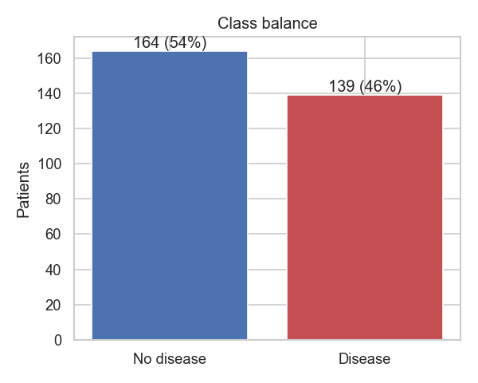
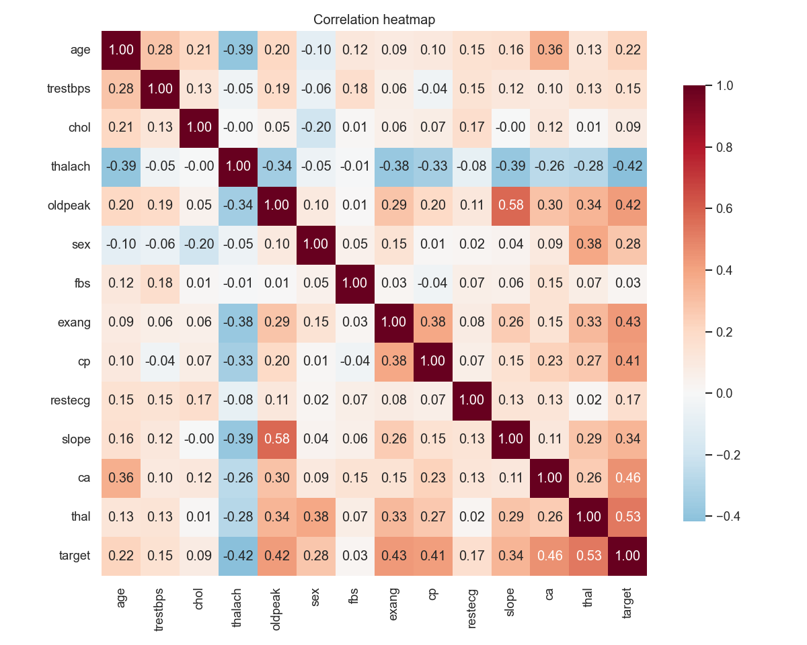
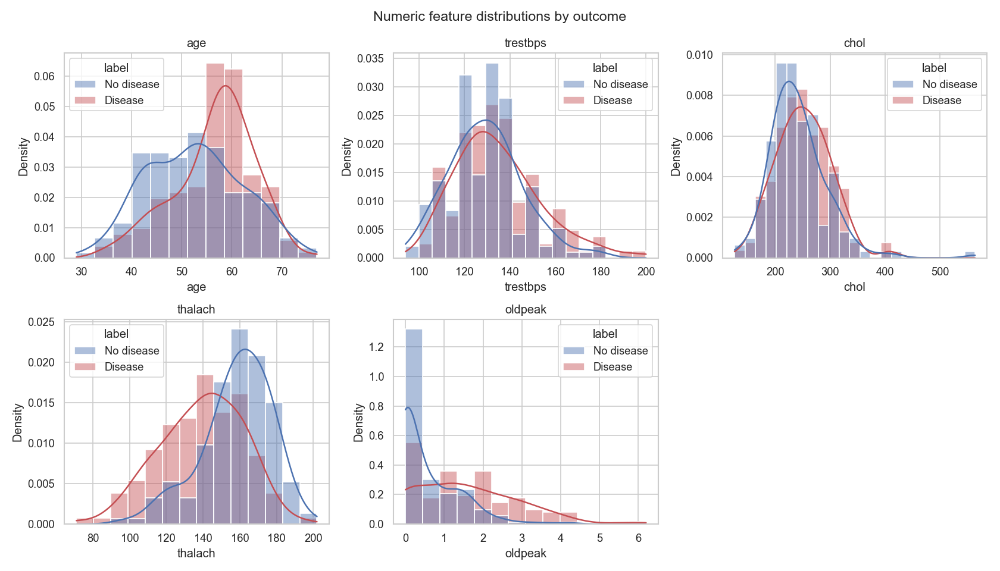
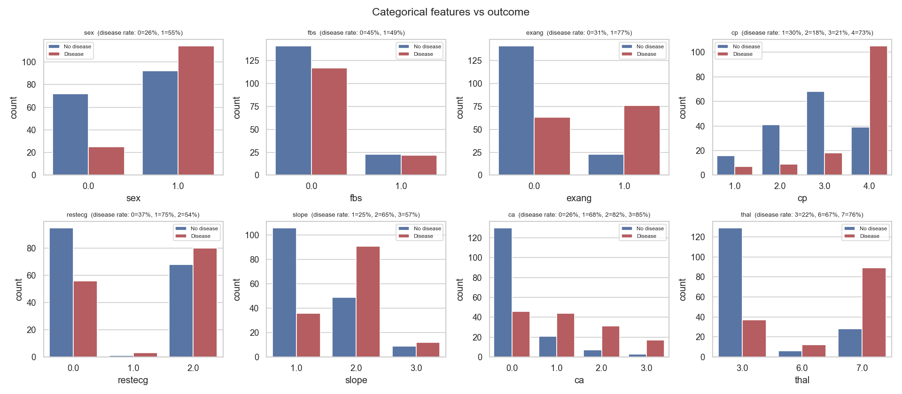
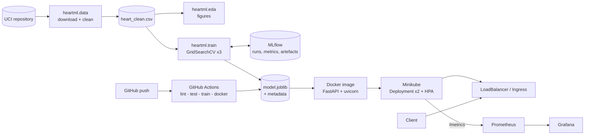

# Heart Disease Risk Prediction - End-to-End MLOps

**Course:** AIMLCZG523 Machine Learning Operations - Assignment 1
**Student:** ABHISHEK PAGARIYA (s2023ae05133)
**Repository:** https://github.com/<your-user>/heart-disease-mlops
**Environment:** BITS Prayogshala virtual lab (MLOPS, Python 3.10)

---

## 1. Problem and dataset

The task is to predict whether a patient has heart disease from 13 clinical attributes, and to deliver the model as a monitored, containerised API.

Data: UCI Heart Disease, Cleveland subset (303 patients, 13 features). The original target `num` (0-4) is collapsed to presence (1-4) vs absence (0).

| Group | Features |
|-------|----------|
| Numeric | age, trestbps (resting BP), chol, thalach (max heart rate), oldpeak (ST depression) |
| Binary | sex, fbs (fasting sugar > 120), exang (exercise angina) |
| Categorical | cp (chest pain type), restecg, slope, ca (vessels coloured), thal |

## 2. Data acquisition and cleaning

`python -m heartml.data` downloads the raw file from UCI and writes `data/processed/heart_clean.csv`.

- `?` markers parsed as missing: `ca` 4 rows, `thal` 2 rows
- target binarised, duplicates dropped (none found)
- numeric values outside clinical ranges are set to missing rather than dropping the patient
- imputation is deliberately **not** done here; it is part of the model pipeline so training and serving share the same logic

## 3. Exploratory data analysis

Figures in `reports/figures/`.

Classes are close to balanced (164 no disease / 139 disease, 46% positive), so accuracy is meaningful, but ROC-AUC and recall are reported as well.

Strongest correlations with the target: thal (0.53), ca (0.46), exang (0.43), oldpeak (0.43), cp (0.41) and thalach (-0.42). Cholesterol and fasting blood sugar are nearly uncorrelated with the outcome in this sample.

Observations:
- patients with disease have visibly lower maximum heart rate and higher ST depression
- asymptomatic chest pain (cp = 4) carries the highest disease rate
- `ca` and `thal` are categorical codes, so they are one-hot encoded rather than scaled

## 4. Feature engineering

Implemented in `heartml/features.py` as a single scikit-learn `Pipeline`:

1. `ClinicalFeatures` adds three domain features
   - `hr_reserve_pct` = thalach / (220 - age): heart rate achieved relative to age-predicted maximum
   - `st_per_hr` = oldpeak / thalach x 100: ST depression normalised by effort
   - `bp_stage2` = resting BP >= 140 mmHg
2. `ColumnTransformer`
   - numeric: median imputation + standard scaling
   - binary: most-frequent imputation
   - categorical: most-frequent imputation + one-hot (unknown categories ignored)

Because preprocessing and model are one object, the saved artefact accepts raw patient JSON.

## 5. Model development and tuning

Three model families, each tuned with `GridSearchCV` (5-fold stratified CV, refit on ROC-AUC) on an 80/20 stratified split (seed 42):

| Model | Grid |
|-------|------|
| Logistic regression | C {0.01..3}, penalty {l1, l2}, class_weight {None, balanced} - 20 candidates |
| Random forest | n_estimators {200, 400}, max_depth {None, 4, 8}, min_samples_leaf {1, 3, 5}, max_features {sqrt, 0.5} - 36 |
| Gradient boosting | n_estimators {100, 200}, learning_rate {0.03, 0.1}, max_depth {2, 3}, subsample {0.8, 1.0} - 16 |

| Model | CV ROC-AUC | CV accuracy | Test ROC-AUC | Test accuracy | Test precision | Test recall | Test F1 |
|-------|-----------:|------------:|-------------:|--------------:|---------------:|------------:|--------:|
| **Logistic regression** | **0.906 +/- 0.013** | 0.839 | 0.968 | 0.885 | 0.839 | 0.929 | 0.881 |
| Random forest | 0.892 +/- 0.025 | 0.801 | 0.960 | 0.902 | 0.867 | 0.929 | 0.897 |
| Gradient boosting | 0.883 +/- 0.024 | 0.814 | 0.959 | 0.902 | 0.867 | 0.929 | 0.897 |

Selected model: **logistic regression, C = 0.3, L1 penalty, balanced class weights**. It has the best and most stable cross-validated ROC-AUC; the test set is only used for reporting, not selection. With 303 rows the simpler model generalises at least as well as the ensembles, and its coefficients are directly interpretable.

## 6. Experiment tracking (MLflow)

Every run of `heartml.train` creates in experiment `heart-disease-classifier`:

- one parent run per model family: search space size, best params, CV mean/std for 5 metrics, test metrics, confusion matrix, ROC curve, feature importance plot + CSV, classification report, full `cv_results.csv`, and the fitted pipeline as an MLflow model with signature and input example
- one nested child run per grid candidate with its params and CV scores (72 in total)
- a `model-selection` run with the comparison table and the chosen model

> Screenshot: MLflow experiment list - `screenshots/mlflow_runs.png`
> Screenshot: MLflow run detail with plots - `screenshots/mlflow_run_detail.png`

## 7. Packaging and reproducibility

- `models/model.joblib`: full preprocessing + model pipeline; also logged as an MLflow sklearn model
- `models/metadata.json`: model name, MLflow run id, params, metrics, Python/sklearn versions, threshold
- pinned `requirements.txt` (full) and `requirements-serve.txt` (runtime only)
- fixed random seeds for split, CV and models
- `scripts/run_pipeline.sh` reproduces everything from a clean clone

## 8. CI/CD

`.github/workflows/ci.yml`: lint -> test -> train -> docker. Each job uploads artefacts (flake8 report, JUnit + coverage, model, mlruns, figures, training log, container logs, image tarball). The train job has a quality gate (test ROC-AUC >= 0.80); the docker job builds the image, runs it and calls `/health`, `/predict` and `/metrics`. Any failure stops the pipeline.

Unit tests (23) cover cleaning, range checks, engineered features, preprocessing (no NaNs, unseen categories, scaling), training, save/load round trip, and every API endpoint including validation errors and the no-model case.

> Screenshot: successful workflow - `screenshots/ci_success.png`
> Screenshot: artefacts list - `screenshots/ci_artifacts.png`
> Screenshot: a failing run (e.g. broken test) - `screenshots/ci_failure.png`

## 9. Containerisation

`python:3.10-slim`, serving dependencies only, non-root user, HEALTHCHECK on `/health`. Inputs are validated with Pydantic (types and clinical ranges); invalid requests return 422.

> Screenshot: `docker build` + `docker run` + curl `/predict` - `screenshots/docker_run.png`

## 10. Deployment

Minikube on the Prayogshala VM (`scripts/deploy_minikube.sh`):

- namespace `heart`, Deployment with 2 replicas, rolling updates, readiness/liveness probes and resource limits
- Service type LoadBalancer (external IP via `minikube tunnel`)
- Ingress `heart-api.local` through the nginx ingress addon
- HorizontalPodAutoscaler 2-5 replicas at 70% CPU

> Screenshot: `kubectl get pods,svc,ingress,hpa -n heart` - `screenshots/k8s_resources.png`
> Screenshot: `/predict` through the LoadBalancer / Ingress - `screenshots/k8s_predict.png`

## 11. Monitoring and logging

- structured JSON log line per request (request id, method, path, status, latency, client) and per prediction (input + output)
- Prometheus metrics: request count by endpoint/status, latency histogram, predictions by class, confidence and probability histograms, model-loaded gauge, error counter
- Prometheus scrapes pods via Kubernetes service discovery; alert rules for target down, p95 latency > 500 ms and 5xx responses
- Grafana dashboard (provisioned): model status, total predictions, predicted disease rate, mean confidence, error rate, RPS, p50/p95/p99 latency, predictions per class, probability distribution

> Screenshot: Grafana dashboard under load (`scripts/load_test.py`) - `screenshots/grafana.png`
> Screenshot: Prometheus targets - `screenshots/prometheus_targets.png`

## 12. Architecture

## 13. Limitations and next steps

- 303 patients from one hospital; external validation on the Hungarian/Swiss/VA subsets would test generalisation
- threshold fixed at 0.5; a clinical deployment would tune it for recall
- model is baked into the image; a model registry + pull-on-start would decouple releases
- no data-drift monitoring yet (the probability histogram is a first proxy)

## 14. How to run

See `README.md`. Short version: `bash scripts/setup_vm.sh && bash scripts/run_pipeline.sh && bash scripts/deploy_minikube.sh`.

**Video:** <link to screen recording>
